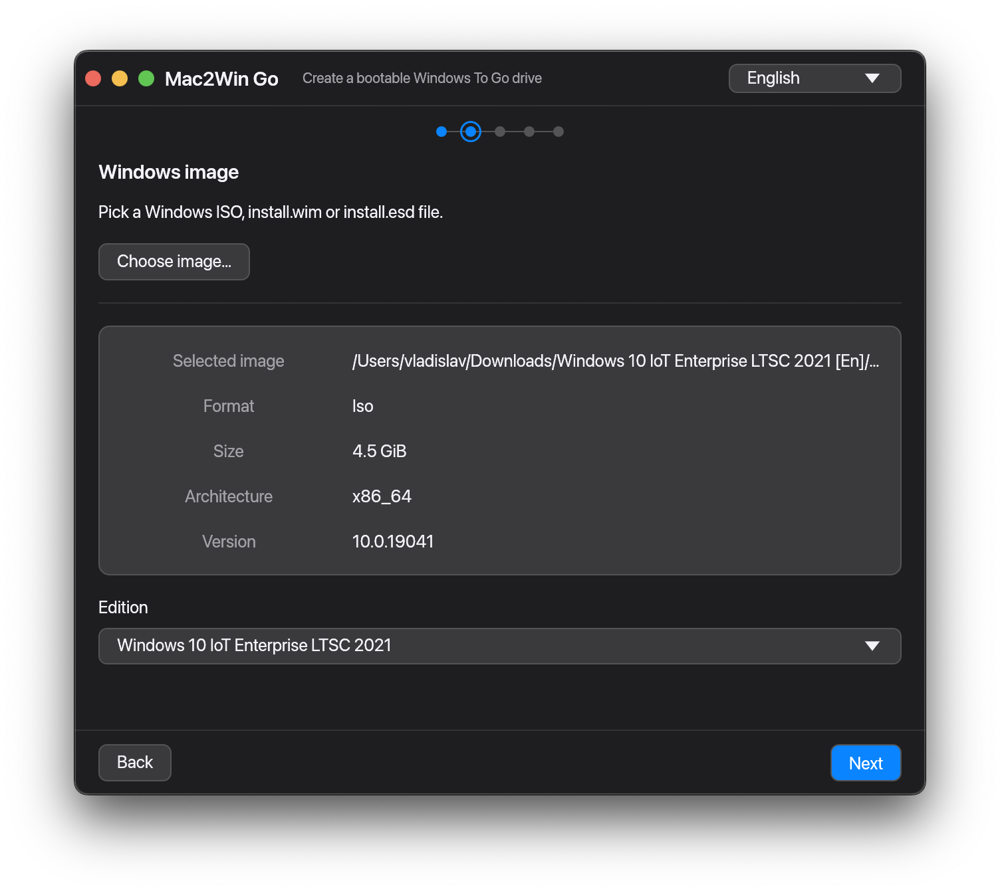

# Mac2Win Go

Desktop application for macOS (Apple Silicon & Intel) that creates a bootable
**Windows To Go** drive on an external USB/Thunderbolt disk.



## Features

- Native, single-binary UI built with [`egui`](https://github.com/emilk/egui) /
  `eframe` — no WebView, no JavaScript.
- Wizard: Welcome → Windows image → Target drive → Options → Confirm → Progress.
- Real detection of external drives on macOS through `diskutil list/info -plist`.
- Real Windows image inspection: `wimlib-imagex info --xml` reads the available
  editions from `install.wim`/`install.esd` (inside an ISO or standalone).
- Real creation pipeline:
  1. unmount the target and validate the plan;
  2. partition it (`diskutil`, GPT + EFI or legacy MBR);
  3. format the ESP (`newfs_msdos`) and the Windows volume (`mkntfs`);
  4. apply the image **directly to the raw NTFS partition**
     (`wimlib-imagex`, built with `libntfs-3g` — no macFUSE required), keeping
     ACLs and file attributes like DISM/Rufus;
  5. patch the applied install offline (via `ntfscat`/`hivexsh`/`ntfscp`):
     `PortableOperatingSystem=1`, `SanPolicy=4`, fast startup and hibernation
     off, and an `unattend.xml` that skips the online-account screens and can
     create a local administrator;
  6. optionally stage the official Steam hardware drivers and install them with
     `pnputil` on first logon (see below);
  7. install the bootloader with [BCD-SYS](https://github.com/jpz4085/BCD-SYS);
  8. optionally verify and eject.
- Optional **Steam hardware driver integration**: download the official Valve
  packages for Steam Deck LCD/OLED or Steam Machine (or point the wizard at
  ZIPs/folders you downloaded yourself), stage them on the drive and install
  them automatically at first logon.
- A single administrator prompt for the whole operation (`sudo`).
- English / Russian UI. Defaults to the system language, switchable in-app and
  persisted between launches.
- Test infrastructure: unit tests, fixture-based parser tests, shell-script
  assertions with a recording `CommandRunner` and headless UI tests.

## Supported Windows versions for Windows To Go

Windows To Go was removed from Windows after 2004 and is *broken again* from
Windows 11 24H2 (build 26100) onwards, where the OOBE boot-loops. Use one of:

| Edition / build | WTG | Notes |
| --- | --- | --- |
| Windows 10 Enterprise/IoT LTSC 2021 (21H2) | yes | recommended: no Store/bloatware, IoT supported to 2032 |
| Windows 10 22H2 | yes | the most tested consumer option |
| Windows 11 22H2 (22621) / 23H2 (22631) | yes | 23H2 is the last safe build |
| Windows 10 LTSC 2019 (1809) | yes | needs the `WppRecorder.sys` workaround |
| Windows 11 24H2 (26100) / LTSC 2024 / 25H2 | **no** | boot-loop during OOBE |
| Windows 11 only (any) | n/a | the old Windows To Go Creator was removed in 2004 |

The wizard reads the build number from the image and shows a warning on the
confirmation step when it detects an unsupported one. The bundled method applies
`install.wim`/`install.esd` directly, so the removed Windows To Go Creator is
not needed.

## First boot on the target PC

- The first boot may take **2–3 attempts**: the firmware/BCD needs to settle and
  Windows rewrites the boot configuration on the first start. Let it retry.
- Fast startup and hibernation are disabled offline
  (`HiberbootEnabled=0`, `HibernateEnabled=0`), and the answer file runs
  `powercfg /h off` at first logon. After logging in, verify with `powercfg /a`.
- If driver integration is enabled, the official Steam drivers are installed
  automatically the first time you sign in (a `pnputil` command runs from
  `unattend.xml`); this can take a few minutes. Without it, install the drivers
  from Valve once you are on the desktop (Wi-Fi, audio, Bluetooth, SD reader).
- `SanPolicy=4` is written to the SYSTEM hive, so Windows does **not**
  automatically mount or write to the host's internal drives (protecting
  SteamOS). Use Disk Management if you deliberately need one.
- The local administrator is created from the wizard's Options step. If you
  leave the account checkbox off, OOBE still offers the offline ("I don't have
  internet") path via `OOBE\BypassNRO=1` (Windows 10 22H2 / Windows 11 23H2).

## Steam hardware drivers (optional)

On the Options step the wizard can stage the official Windows drivers for
Steam Deck LCD, Steam Deck OLED or Steam Machine:

- **Automatic** — the official packages are downloaded from Valve's CDN
  (`steamdeck-packages.steamos.cloud`, the links from the Steam "Windows
  Resources" page) and extracted before anything is written.
- **From files** — pick one or more ZIP archives and/or already extracted
  folders you downloaded yourself (works offline).

Because the image is applied directly, the DISM `offlineServicing` driver
injection path is not available on macOS. Instead the driver tree is captured
into a small overlay WIM and applied on top of the fresh NTFS volume (the
bundled `ntfscp` cannot create directories), and an `unattend.xml`
`FirstLogonCommands` entry runs
`pnputil /add-driver C:\SteamDeckDrivers\*.inf /subdirs /install`. The result:
the drivers are installed automatically the first time you sign in, without
touching the OOBE flow (which stays offline-first).

Notes and limitations:

- Drivers require an `x86_64` image; the wizard blocks other architectures.
- Expect ~1.5 GB of downloads and extra time/space for the overlay WIM; the
  target size check accounts for it.
- The AMD APU package is installed as an INF; AMD's companion software is not.
- The in-app manifest hard-codes the current Valve URLs. If Valve moves a file,
  use the "from files" option or update `src/core/drivers.rs`.

## Out of the box

No Homebrew/MacPorts installs are required for end users: the helper binaries are
built (universal arm64 + x86_64) and shipped inside the `.app` bundle under
`Contents/Resources/tools`. See [`vendor/tools/README.md`](vendor/tools/README.md).

During development the tools can live in `vendor/tools`, be pointed at through
`MAC2WINGO_TOOLS`, or simply be on `PATH`.

## Requirements (build)

- macOS 11+.
- Rust stable (1.95+). Install with [rustup](https://rustup.rs).
- Xcode command line tools (only when building the bundled helper tools).
- GNU autotools and related build tools (only when building the bundled
  helper tools): `brew install autoconf automake libtool gettext pkgconf`.

## Build & run

```sh
./scripts/fetch-tools.sh   # builds the universal helper tools (once)
cargo run
```

## Quality checks

```sh
cargo fmt --all -- --check
cargo clippy --all-targets --all-features -- -D warnings
cargo test --all-features
```

There is also a `justfile` (`just check`, `just test`, `just lint`).

GitHub Actions runs the same checks on pushes to `main` and pull requests
(`.github/workflows/ci.yml`). Pushing a `v*` tag triggers the release pipeline
(`.github/workflows/release.yml`), which builds the universal app and a DMG and
attaches the DMG both as a workflow artifact and to a GitHub Release.

## Universal `.app` bundle

Produces `dist/Mac2Win Go.app` containing a universal binary plus the helper
tools:

```sh
./scripts/build-universal.sh
```

### DMG

Package the bundle into a distributable disk image, `dist/Mac2WinGo-<version>.dmg`
(version taken from `Cargo.toml`):

```sh
./scripts/build-dmg.sh   # or: just dmg
```

The image is a styled installer: it opens with the app on the left, an
`Applications` shortcut on the right and a `How to open.txt` note below, so the
app can be dragged into `/Applications` like any standard macOS package. The
window layout, background and icon positions are applied by
[dmgbuild](https://github.com/dmgbuild/dmgbuild), which writes the Finder
`.DS_Store` directly and therefore works on headless CI runners (no
Finder/AppleScript). If `dmgbuild` is not installed, `build-dmg.sh` provisions it
into `target/dmgbuild-venv` on first run; set `DMGBUILD` to point at an existing
executable instead.

### Signing, notarization and Gatekeeper

A Developer ID signature with hardened runtime plus Apple notarization is the
only way to make a downloaded build open with no Gatekeeper warning. The release
pipeline signs and notarizes both the app and the DMG through
`scripts/sign-and-notarize.sh`; it needs a paid Apple Developer Program
membership and these repository secrets:

| Secret | Purpose |
| --- | --- |
| `APPLE_CERTIFICATE` | base64 of the Developer ID Application `.p12` |
| `APPLE_CERTIFICATE_PASSWORD` | password for that `.p12` |
| `APPLE_SIGNING_IDENTITY` | `Developer ID Application: Name (TEAMID)` |
| `APPLE_API_KEY` | base64 (or PEM) of the App Store Connect `.p8` key |
| `APPLE_API_KEY_ID`, `APPLE_API_ISSUER` | the key id and issuer id |

`APPLE_ID` + `APPLE_TEAM_ID` + `APPLE_APP_SPECIFIC_PASSWORD` are accepted as an
alternative to the API key.

Locally, when `MAC2WINGO_SIGN_IDENTITY` is unset, `sign-and-notarize.sh` falls
back to ad-hoc signing (the script above works unchanged), and `build-universal.sh`
still produces a runnable `dist/Mac2Win Go.app`. Ad-hoc builds (and any build
without notarization) are blocked by Gatekeeper once they carry the
`com.apple.quarantine` flag from a browser download. The DMG ships a
`How to open.txt` note that walks users through the three options:

1. Drag the app to `/Applications`, try to open it, then open System Settings →
   Privacy & Security and click **Open Anyway** (Apple's official flow; the
   older control-click → Open shortcut is gone in macOS 15+).
2. Clear the flag from the terminal:
   ```sh
   xattr -dr com.apple.quarantine "/Applications/Mac2Win Go.app"
   ```
3. Clear it on the downloaded image before opening it, so nothing inside is
   quarantined:
   ```sh
   xattr -dr com.apple.quarantine ~/Downloads/Mac2WinGo-<version>.dmg
   ```

There is no free way to remove the warning entirely: notarization requires a paid
Developer ID certificate, and a `.command`/script shipped in the DMG does not
help because Gatekeeper blocks the script itself for the same reason. Downloads
via `git clone`, `curl` or a package manager that strips the quarantine attribute
are not affected.


The background (`assets/dmg_background.png` plus its `@2x` variant) is generated
from a Rust drawing:

```sh
./scripts/generate-dmg-background.sh   # or: just dmg-bg
```

### App icon

The bundle icon (`assets/AppIcon.icns`) and the runtime Dock icon
(`assets/icon_512.png`, embedded in the binary) are generated from a Rust
drawing:

```sh
./scripts/generate-icon.sh   # or: just icon
```

The icon is also set at runtime through `NSApplication.setApplicationIconImage`
(eframe only does this when an icon is supplied), so the Dock shows it even when
the binary is launched outside the `.app`. If macOS keeps showing a stale icon,
clear the cache with `killall Dock` or drag the app out of the Dock and back in.

## Project layout

```
src/
├── main.rs              # binary entry point (tracing + eframe)
├── lib.rs               # library root (also used by tests)
├── app.rs               # wizard state machine, service wiring
├── i18n.rs              # English / Russian translations
├── core/                # platform-independent domain + contracts
│   ├── command.rs       # CommandRunner abstraction + shell quoting
│   ├── device.rs        # DiskDevice, DeviceService
│   ├── image.rs         # WindowsImage, ImageEdition, wimlib XML parser
│   ├── drivers.rs       # Steam hardware driver manifest + DriverSource
│   ├── writer.rs        # WindowsToGoWriter, WritePlan
│   ├── progress.rs      # Stage, ProgressEvent, ProgressSink
│   ├── options.rs       # WriteOptions
│   ├── config.rs        # persisted AppConfig
│   └── error.rs         # CoreError
├── platform/macos/      # diskutil parsing, tool locator, sudo runner
├── services/            # real + stub + mock service implementations
└── ui/                  # egui wizard, macOS theme/controls, steps and widgets
assets/                  # generated app icon (.icns + embedded PNG)
examples/gen_icon.rs     # draws the icon with tiny-skia
```

The domain in `core/` is free of UI dependencies and can be reused from a future
CLI. External commands are abstracted behind `CommandRunner` so the writer is
tested by asserting the generated privileged script; device parsing is tested
against recorded fixtures in `tests/fixtures/`.

## Limitations

- Only one edition is installed per drive (the one selected in the wizard).
- Legacy BIOS support depends on `ms-sys` and has not been validated on real
  hardware as much as the UEFI path.
- Boot success depends on firmware/BCD portability and Secure Boot settings of
  the target machine; test on the actual hardware.
- Windows 11 24H2+ will not boot as Windows To Go; the wizard only warns, it
  does not block the write.
- The ESP cluster size follows the device's logical sector size. On native 4Kn
  media the ~200 MB default ESP is below the FAT32 minimum (~256 MB for 4 KiB
  clusters), so formatting can fail; use a 512e drive.
- `unattend.xml` is written to `\Windows\Panther\unattend.xml`, falling back to
  `\Windows\System32\Sysprep\unattend.xml` if Panther is absent.
- The app bundle contains GPL/LGPL helper programs (`wimlib`, ntfs-3g, ms-sys,
  BCD-SYS, bash, mtools, hivex, readpe). Their license texts and a
  corresponding-source offer ship inside the bundle and in `licenses/`; see
  [THIRD_PARTY_NOTICES.md](THIRD_PARTY_NOTICES.md).

## License

The Mac2Win Go application code is released under the [MIT License](LICENSE).

The bundle also contains third-party helper programs under the GPL and LGPL.
They keep their own licenses, are invoked as separate processes (not linked into
the application), and their source — including every patch applied when building
them — is available from this repository. See
[THIRD_PARTY_NOTICES.md](THIRD_PARTY_NOTICES.md) and
[licenses/SOURCE_OFFER.md](licenses/SOURCE_OFFER.md).
